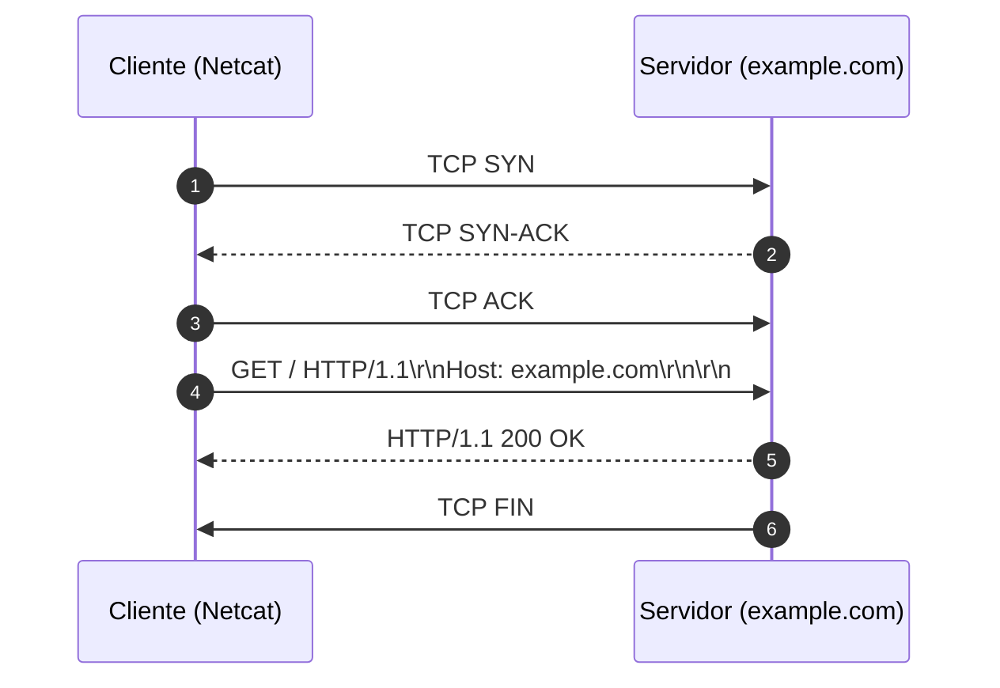

# Memória de Desenvolvimento — Semana 01
**Aluno:** [Carolina Viana de Souza]  
**Matrícula:** [202311250148]  
**Curso:** Engenharia da Computação  

---

## 1. Mapeamento da Camada de Transporte
Diagrama Mermaid demonstrando o ciclo de vida da requisição executada no laboratório:

---

## 2. Captura Bruta e Análise do Protocolo
* **Comando Utilizado:** `nc -C example.com 80`
* **Status Line Retornada:** `HTTP/1.1 200 OK`

### Análise dos Headers Recebidos:
1. **`Content-Type`:** [text/html; charset=utf-8: Indica que o conteúdo do corpo é um documento HTML codificado em UTF-8.
O campo do cabeçalho 'Content-Type' é o responsável por instruir o cliente sobre como interpretar a sequência de bytes recebida
no corpo da resposta.]
3. **`Content-Length`:** [O protocolo TCP é uma byte stream contínua, não possui um delimitador de "fim de mensagem" dentro da
transmissão de dados. Cabe ao protocolo HTTP saber onde a resposta termina. O 'Content-Length' informa o tamanho do payload
(corpo da resposta). O parser lê o cabeçalho, descobre o tamanho exato e continua consumindo os bytes vindos do socket até
atingir essa contagem. Isso permite que o cliente saiba exatamente quando terminar de ler o corpo da mensagem sem precisar
fechar o socket TCP. É fundamental para permitir conexões persistentes (keep-alive).]
7. **`Connection: close`:** [Connection: close: Indica que o modelo de comunicação é não-persistente. Assim que o servidor
terminar de transmitir o último byte do payload, ele enviará um pacote TCP FIN para encerrar e fechar o socket TCP imediatamente.
Toda nova requisição posterior exigirá o custo de abrir um novo handshake TCP
'Connection: keep-alive': Mantém a conexão TCP aberta e reutilizável após o término da resposta. O cliente pode enviar outra requisição
HTTP através do mesmo socket já aberto, economizando tempo de latência e processamento de rede.]

---

## 3. Conclusão Técnica
[O protocolo HTTP é textual e opera sobre um stream (fluxo contínuo) TCP, que, diferente de um arquivo estático local, não possui
tamanho definido. Na transmissão TCP contínua de bytes ASCII, delimitada por sequências de CRLF (\r\n), os campos do cabeçalhos orientam
o parser sobre o fim do cabeçalho (duplo CRLF), interpretação do conteúdo da mensagem (Content-Type), contagem dos bytes recebidos
(Content-Length) e o ciclo de vida do socket (Connection). Todas essas informações combinadas permitem diagnosticar falhas, diminuir
latência com conexões persistentes etc]
